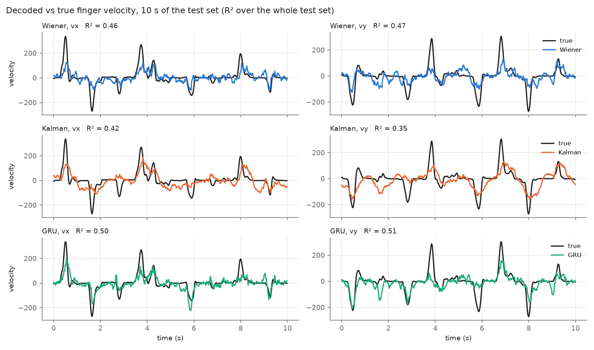

# MC_RTT streaming decoder

Decoding finger velocity from motor-cortex spikes, causally, as a real-time brain-computer interface would.

**Question.** How much accuracy does a recurrent decoder gain over the classic Kalman filter on continuous reaching, and what does the Kalman filter cost to run in real time in fixed point?

**Status.** Python decoders done (Wiener, Kalman, GRU). The fixed-point C++ port of the Kalman decoder is in progress.

## Results

Velocity R² on the held-out test set (last 20% of the session). All decoders are causal and were tuned on the validation split only.

| Decoder                                   | R² x      | R² y      | Mean              | Settings (chosen on val)   |
| ----------------------------------------- | --------- | --------- | ----------------- | -------------------------- |
| Single-bin ridge (baseline)               | 0.203     | 0.167     | 0.185             | α = 1                      |
| Wiener filter                             | 0.459     | 0.470     | 0.465             | 10 bins (200 ms), α = 1000 |
| Kalman, velocity state                    | 0.181     | 0.109     | 0.145             | full filter                |
| Kalman, position + velocity               | 0.422     | 0.350     | 0.386             | full filter                |
| Kalman, position + velocity, steady state | 0.424     | 0.352     | 0.388             | fixed gain                 |
| **GRU**                                   | **0.502** | **0.536** | **0.512 ± 0.010** | 64 hidden units, 3 seeds   |

For the GRU, the ± is the standard deviation over 3 seeds (x ± 0.013, y ± 0.007).



The Kalman filter is the smoothest decoder but lags behind fast movements. The GRU follows the peaks best. All three underestimate the fastest reaches.

**Takeaways**

- **The GRU is the best decoder**, ahead of the Wiener filter by 0.05 R² and the best Kalman filter by 0.13, with a small spread across seeds.
- **The steady-state Kalman filter loses nothing** compared to the full filter (0.388 vs 0.386). That fixed-gain recurrence, x ← Mx + Ky, is the version being ported to C++.
- **Adding position to the Kalman state more than doubles its R²** (0.145 → 0.386). Motor-cortex neurons also encode hand position, so a velocity-only model counts that part of their firing as noise.
- **The Kalman filter stays below the Wiener filter at 20 ms bins.** With 0 to 3 spikes per unit per bin, the counts are far from the Gaussian noise the Kalman model assumes, while the Wiener filter's 2,600 free weights assume less.

## Data

[MC_RTT](https://dandiarchive.org/dandiset/000129) from the Neural Latents Benchmark: one monkey (Indy) reaching continuously to random targets.

- **Recording:** 130 sorted units, 10.8 minutes, finger velocity as the target (`finger_vel`, x and y).
- **Binning:** spikes counted in 20 ms bins (32,455 bins, at most 3 spikes per unit per bin).
- **Causal split:** first 70% train, next 10% validation, last 20% test, in time order with no shuffling.
- **Lag:** spikes at time t are paired with velocity at t + 120 ms, the lag that maximised validation R². Neural activity leads movement.
- **Gaps:** about 0.05% of bins are missing. They are flagged instead of removed, so consecutive bins stay consecutive, and they are excluded when fitting and scoring.

## Decoders

- **Wiener filter:** ridge regression from the last 10 bins of spike counts (130 × 10 features) to velocity.
- **Kalman filter:** linear-Gaussian state-space model, with state [position, velocity], dynamics x*t = A x*{t−1} + w, observations y_t = C x_t + q. A, C, W and Q are fitted by least squares on training data. The steady-state gain comes from the discrete algebraic Riccati equation.
- **GRU:** one layer, 64 hidden units, linear readout. Trained on 3 s sequences with masked MSE, AdamW and early stopping on validation R². At test time it runs over the whole test block as one causal sequence.

## Reproduce

Windows, PowerShell, from the repo root. Requires [uv](https://docs.astral.sh/uv/) and the official Python 3.12 from python.org.

```powershell
# Environment
& "$env:LOCALAPPDATA\Programs\Python\Python312\python.exe" -m venv .venv
uv pip install --python .venv -r requirements.txt
uv pip install --python .venv --no-deps nlb_tools
uv pip install --python .venv torch --index-url https://download.pytorch.org/whl/cpu

# Data (about 50 MB)
mkdir data
uvx dandi download DANDI:000129/draft -o data

# Results table
.venv\Scripts\python.exe python/decoders.py

# Velocity figure -> figures/velocity.png
.venv\Scripts\python.exe python/plot_velocity.py

# Kalman matrices + test data for the C++ port -> export/
.venv\Scripts\python.exe python/export.py
```

`python/data.py` run on its own prints the dataset summary and the lag search.

## Repository layout

```
README.md
requirements.txt
python/
  data.py                      load, bin to 20 ms, causal split, lag search
  decoders.py                  Wiener, Kalman, GRU, tuning and the results table
  plot_velocity.py             decoded vs true velocity figure
  export.py                    steady-state Kalman matrices + test set for C++
  notebooks/00_explore_data.ipynb   raster, velocity, firing rates, tuning curves
figures/                       velocity.png
export/                        kalman/*.csv, test/*.csv, meta.json (from export.py)
data/                          downloaded dataset (not in git)
```

## Next steps

- **Fixed-point C++:** port the steady-state Kalman decoder to C++17, in double precision (Eigen) and in fixed point (`int32_t` with `int64_t` accumulators). Test both against Python (to about 1e-9 for double, bit-exact against a numpy integer emulation for fixed point). Sweep fractional bits from 8 to 20, and measure latency per 20 ms bin.
- **Beyond:** streaming state-space-model decoders and an FPGA deployment.
